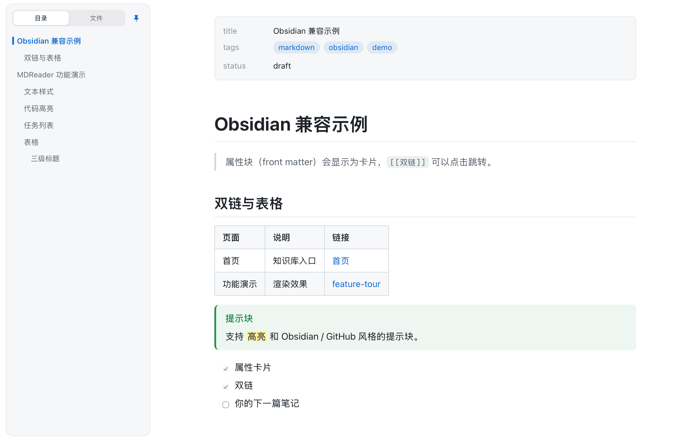
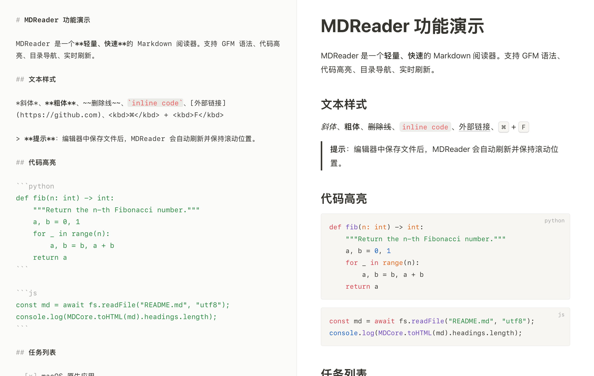
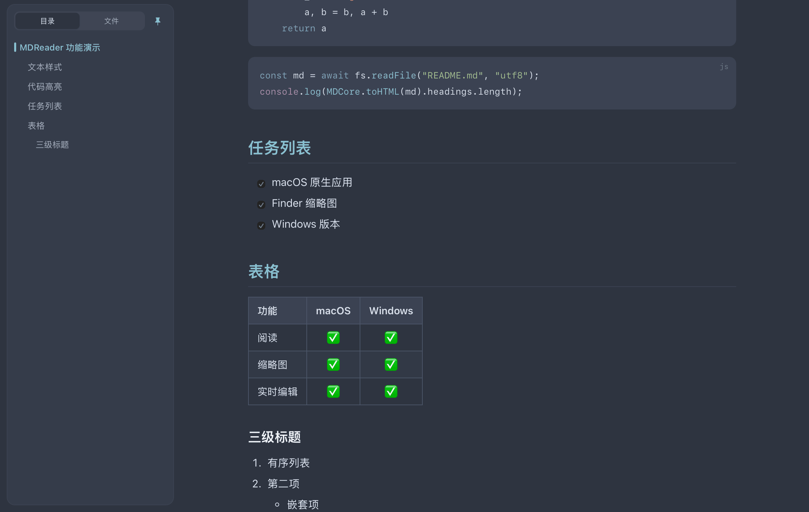
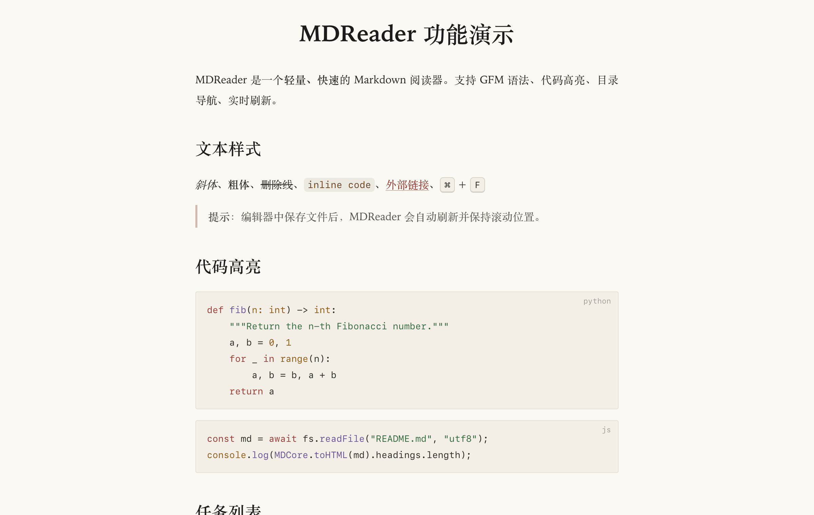
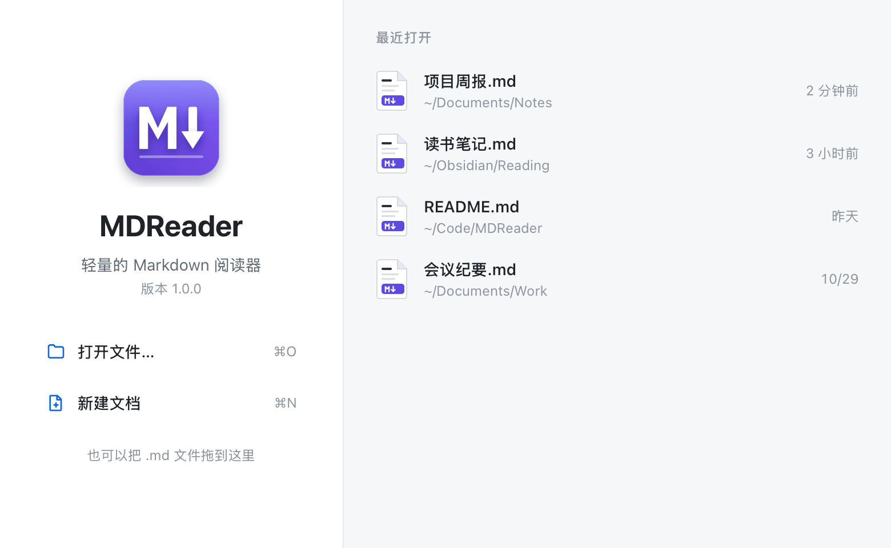
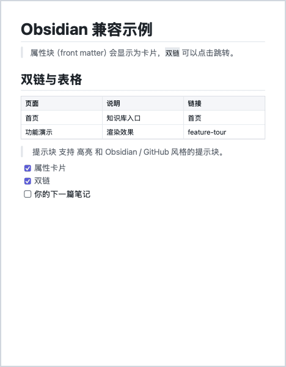

<p align="center">
  
</p>

<h1 align="center">MDReader</h1>

<p align="center">
  <b>轻量、快速、好看的 Markdown 阅读器 · macOS & Windows</b><br>
  A lightweight, fast and beautiful Markdown reader & editor for macOS and Windows —
  with Finder / Explorer thumbnails, Quick Look preview, live split editing and Obsidian support.
</p>

<p align="center">
  <a href="https://github.com/x2724009/MDReader/releases/latest"></a>
  
  
  
  <a href="LICENSE"></a>
</p>

<p align="center"></p>

[中文](#中文) · [English](#english)

---

## 中文

### 为什么是 MDReader

- **轻**：Mac 安装包约 2 MB，Windows 约 1 MB；原生外壳 + 系统 WebView，不捆绑 Chromium / Electron。
- **快**：WebView 预热，双击 `.md` 立即显示；骨架屏 + 淡入过渡。
- **看得见**：Finder / 资源管理器里的 `.md` 图标直接显示文档首页缩略图；Mac 上空格键快速预览。
- **能写**：⌘E / Ctrl+E 进入分栏编辑，左边源码（语法着色）右边实时预览；两边光标与滚动双向同步；自动保存并保留原文件编码（UTF-8 / UTF-16 / GBK·GB18030）。

### 功能

| | |
|---|---|
| 渲染 | GFM：表格、任务列表、删除线、代码高亮（highlight.js）、内嵌 HTML |
| Obsidian | 属性卡片（front matter）、`[[双链]]`（含表格中的 `[[a\|b]]`）、`> [!tip]` 提示块、`==高亮==` |
| 风格 | GitHub、Notion、学术（衬线纸张）、Nord，各有浅色 / 深色，可跟随系统 |
| 侧栏 | 目录（滚动高亮当前章节）+ 文件浏览（路径面包屑）；左边缘悬停临时展开，3 秒后自动收起 |
| 编辑 | 分栏实时预览、预览中闪烁光标定位、点击预览跳回源码、列表/引用自动续写、⌘B / ⌘I / ⌘K |
| 文件 | 外部修改自动刷新、导出 PDF、打印、最近文件、拖拽打开、欢迎页 |
| macOS | 多文档合并为标签页、Quick Look 预览扩展、缩略图扩展、深色模式 |
| Windows | 资源管理器缩略图（IThumbnailProvider）、文件关联、免管理员安装、便携版 |

<p align="center">
  
  
</p>
<p align="center">
  
  
</p>
<p align="center"><br><sub>Finder / 资源管理器中的 .md 缩略图</sub></p>

### 下载安装

到 [Releases](https://github.com/x2724009/MDReader/releases/latest) 下载：

- **macOS**：`MDReader-x.y.z-mac.dmg`（Apple 芯片 + Intel 通用）。拖到「应用程序」。
  首次打开如提示“无法验证开发者”：在 Finder 中右键 → 打开，或执行
  `xattr -dr com.apple.quarantine /Applications/MDReader.app`（应用未经 Apple 公证）。
  缩略图不出现时执行 `qlmanage -r && qlmanage -r cache` 或注销一次。
- **Windows**：`MDReader-x.y.z-win-x64-setup.exe`（无需管理员权限），或便携版 `…-portable.zip`。
  需要 Microsoft Edge WebView2 运行时（Windows 10/11 通常已自带，缺失时安装程序会引导下载）。
  若 SmartScreen 提示，点「更多信息 → 仍要运行」（安装包未做代码签名）。

### 快捷键

| 功能 | macOS | Windows |
|---|---|---|
| 打开 / 新建 | ⌘O / ⌘N | Ctrl+O / Ctrl+N |
| 编辑 / 阅读切换 | ⌘E | Ctrl+E |
| 查找 | ⌘F、⌘G | Ctrl+F、Ctrl+G |
| 目录侧栏 | ⌃⌘S | Ctrl+\\ |
| 字号 | ⌘+ / ⌘- / ⌘0 | Ctrl+ / Ctrl- / Ctrl+0 |
| 导出 PDF | ⇧⌘E | Ctrl+Shift+E |

### 从源码构建

```bash
# macOS（需要 Xcode 与 XcodeGen：brew install xcodegen）
./scripts/build-mac.sh --install     # 构建并安装到 /Applications
./scripts/package-mac.sh             # 生成 dist/MDReader-<版本>-mac.dmg
```

Windows（Visual Studio 2022 + CMake，WebView2 SDK 来自 NuGet）：

```powershell
cmake -S win -B build/win -A x64 -DWEBVIEW2_DIR=<解压后的 Microsoft.Web.WebView2 包目录>
cmake --build build/win --config Release
```

推送 `v*` 标签后，GitHub Actions 会自动构建 DMG、Windows 安装包和便携版并发布到 Releases（见 `.github/workflows/release.yml`）。

### 项目结构

```
shared/web/        渲染与界面（marked + highlight.js），Mac 与 Windows 共用
  render-core.js   Markdown → HTML（双链、提示块、属性卡片、源码行号映射）
  reader.js        阅读页：目录、文件侧栏、查找、主题、编辑同步
  editor.js        轻量源码编辑器（语法着色、列表续写、原生撤销）
  start.*          欢迎页     shell.*  Windows 页内工具栏
mac/App            AppKit 外壳（NSDocument、WKWebView 预热池、标签页、标题栏）
mac/Thumbnail      Finder 缩略图扩展（Core Graphics 绘制）
mac/Preview        空格键 Quick Look 预览（JavaScriptCore 运行同一渲染器）
win/MDReader       Win32 + WebView2 外壳
win/Thumbnail      资源管理器缩略图（GDI+）
win/installer      Inno Setup 安装脚本
```

### 参与

欢迎 Issue 和 PR：新风格主题、语言、Linux 版本、Mermaid / KaTeX 支持……  
如果 MDReader 对你有用，点个 ⭐ Star 让更多人看到。

---

## English

**MDReader** is a tiny native Markdown viewer and editor for **macOS** and **Windows**. It uses the system WebView (WKWebView / WebView2) instead of bundling a browser, so the download is about **2 MB**.

**Highlights**

- Finder / Explorer **thumbnails** that show the first page of each `.md` file; **Quick Look** (space bar) preview on macOS.
- **Split editing** with live preview, two-way caret & scroll sync (click the preview to jump to the source), autosave that keeps the original encoding.
- **Obsidian-friendly**: front-matter properties card, `[[wikilinks]]` (also inside tables), callouts `> [!note]`, `==highlights==`.
- Four reading styles — **GitHub, Notion, Academic, Nord** — each with light & dark.
- Outline + file-browser sidebar with breadcrumb; hover the left edge to peek, auto-hides after 3 s.
- Live reload on external changes, export to PDF, print, recent files, drag & drop, welcome page, tabs (macOS).

**Install** — grab the latest build from [Releases](https://github.com/x2724009/MDReader/releases/latest):
`MDReader-x.y.z-mac.dmg` (universal) or `MDReader-x.y.z-win-x64-setup.exe` / portable zip.
Builds are not notarized/code-signed: on macOS use right-click → Open the first time; on Windows choose “More info → Run anyway”.

**Build** — see the commands above (`scripts/build-mac.sh`, CMake for Windows). Tagging `vX.Y.Z` triggers the release workflow.

**License** — MIT. Bundles [marked](https://github.com/markedjs/marked) (MIT) and [highlight.js](https://github.com/highlightjs/highlight.js) (BSD-3-Clause).

<!-- keywords: markdown viewer, markdown reader, markdown editor, md viewer, macOS markdown app, windows markdown viewer, quick look markdown, finder thumbnail markdown, explorer thumbnail markdown, obsidian viewer, wikilinks, lightweight, webview2, swift, appkit -->
